# m_opslog_topo

存储网络拓扑图生成器。把 **交换机日志** 和 **config.txt** 合成一张可交互的 SAN/NAS 拓扑图，输出为**单个离线 HTML 文件**（数据、样式、JS 全部内联，双击即可打开，不发任何网络请求）。


> **一句话**：输入交换机日志 + config.txt，输出一张可交互、可导出、完全离线的 SAN/NAS 拓扑图；也支持 graph.json 与 CMDB / API 适配器。

**文档地图**：[图数据契约](docs/graph-schema.md) · [架构与演进](docs/architecture.md) · [适配器契约](adapters/README.md) · [示例数据](sample/) · [最新 HTML](topology.html)

<a id="toc"></a>

## 目录

- [1. 特性](#sec-1)
- [2. 快速开始](#sec-2)
- [3. 中间产物与二次开发](#sec-3)
- [4. 输入、输出与依赖](#sec-4)
  - [4.1 数据流](#sec-4-1)
  - [4.2 输入 A：config.txt（主机 / 存储）](#sec-4-2)
  - [4.3 输入 B：交换机日志](#sec-4-3)
  - [4.4 输入 C：graph.json（可选）](#sec-4-4)
  - [4.5 输入 D：CMDB / API 适配器](#sec-4-5)
  - [4.6 命令行参数](#sec-4-6)
  - [4.7 输出](#sec-4-7)
  - [4.8 构建依赖](#sec-4-8)
  - [4.9 运行时依赖](#sec-4-9)
  - [4.10 数据质量检查清单](#sec-4-10)
  - [4.11 文件规模参考](#sec-4-11)
- [5. 界面与筛选](#sec-5)
  - [5.1 顶栏](#sec-5-1)
  - [5.2 导出与视图](#sec-5-2)
  - [5.3 设备视图 / 端口视图](#sec-5-3)
  - [5.4 视觉风格](#sec-5-4)
  - [5.5 主机组折叠（辅助功能）](#sec-5-5)
  - [5.6 健康状态](#sec-5-6)
  - [5.7 SAN/NAS 冗余分析](#sec-5-7)
  - [5.8 端口矩阵](#sec-5-8)
  - [5.9 分析范围](#sec-5-9)
  - [5.10 列标题与背景带](#sec-5-10)
  - [5.11 链路自动聚合](#sec-5-11)
  - [5.12 范围面板](#sec-5-12)
  - [5.13 精细筛选器](#sec-5-13)
  - [5.14 几百台主机时的筛选器](#sec-5-14)
  - [5.15 已生效筛选条](#sec-5-15)
  - [5.16 其他操作](#sec-5-16)
- [6. 目录结构](#sec-6)
- [7. 输入格式](#sec-7)
  - [7.1 config.txt（主机 + 存储）](#sec-7-1)
  - [7.2 交换机日志](#sec-7-2)
  - [7.3 WWN 匹配逻辑](#sec-7-3)
  - [7.4 层级是怎么算的](#sec-7-4)
- [8. 扩展性（给后续开发）](#sec-8)
  - [8.1 先理解契约](#sec-8-1)
  - [8.2 加信息：优先走 `meta`](#sec-8-2)
  - [8.3 加筛选 / 视图](#sec-8-3)
  - [8.4 加设备类型 / 链路类型（较大）](#sec-8-4)
  - [8.5 加数据源（推荐方式）](#sec-8-5)
  - [8.6 加视觉风格 / 卡片](#sec-8-6)
  - [8.7 大规模能力路线](#sec-8-7)
  - [8.8 改动后的验收](#sec-8-8)
- [9. 大规模场景：搜索、过滤与导出](#sec-9)
  - [9.1 搜索](#sec-9-1)
  - [9.2 过滤](#sec-9-2)
  - [9.3 图片导出](#sec-9-3)
  - [9.4 全局清单导出](#sec-9-4)
  - [9.5 完整全图高清导出（未实现）](#sec-9-5)
  - [9.6 容量判断](#sec-9-6)
- [10. 常见问题](#sec-10)
- [11. 已知边界](#sec-11)

<a id="sec-1"></a>

## 1. 特性

- **两套界面风格**：
  - **经典（默认）**：蓝色主色、柔和圆角、轻阴影，就是最初那版
  - **shadcn**：zinc 中性色、8px 圆角、细边框、Dialog / Tabs / Checkbox / Badge / Toast 的 shadcn 形态
  - 在「显示选项 → 界面风格」切换，组件结构不变，只换 token，选择会本地记忆
- **三套节点风格**：
  - **线稿（默认）**：白底 + 类型色细边框 + 线框图标 + 端口点阵
  - **shadcn**：纯中性卡片，无类型色；靠线框图标与文字标签区分，未识别设备用虚线边框
  - **机架拟物**：真实前面板、机架挡板与导轨
  - 顶栏节点风格下拉或「显示选项 → 节点风格」切换，选择会保存在浏览器本地
- **主机组折叠（辅助）**：默认关闭；勾选「显示选项 → 折叠主机（按接入交换机）」后，主机折叠成 `主机组 ×N`，可看成员、**仅展开此组**或展开全部主机；端口视图自动禁用；组卡带叠层效果
- **分析范围**：按 `meta.site` / `meta.fabric` / `meta.rack` 过滤；没有这些元数据时自动隐藏；无字段的共享设备保留
- **端口矩阵**：设备详情 → 端口矩阵，表格看端口 ↔ 对端、状态、WWN，可搜索和导出 CSV
- **健康状态覆盖**：设备卡状态点 + 异常链路红色虚线；概览、图例、详情、端口矩阵、清单都带健康状态
- **SAN/NAS 冗余分析**：概览卡 → 冗余分析，主机 × 存储矩阵，节点不交路径 0/1/2；NAS 按 storage 统一处理
- **全局清单导出**：导出菜单 → 设备 / 端口 / 链路 CSV（全部数据）
- **CMDB / API 适配器**：`--adapter path.py:func --adapter-input`，示例见 `adapters/`
- **搜索结果批量操作**：搜索后出现「全选结果 / 清空结果」，分组头也切换为结果级操作；底部保留全选全部/全不选全部
- **紧凑顶栏**：品牌 + SAN · NAS 标识、设备概览按钮、统一工具栏；节点风格与明暗主题相邻组成 UI 组，悬停控件会显示用途提示，经典 / shadcn 两套 token 共用
- **设备概览卡**：设备数、链路数、端口数、类型分布、数据来源和时间收进一张可扩展的 card，点按钮弹出
- **多格式 / 高清导出**：PNG（无损）/ JPG / WebP；清晰度 1× / 2× / 3×，2×/3× 是重新高分辨率渲染，不是放大模糊图
- **列标题 + 背景带**：主机 / 接入 / 核心 / 存储列有独立标签和淡色背景带；低缩放自动隐藏标签
- **链路自动聚合**：设备视图链路超过 300 条且主机 ≥20 时自动折叠成主机组，chip 可随时关闭
- **侧栏渐进披露**：低频显示项收进「高级显示」，基础侧栏只保留高频操作
- **侧栏折叠 / 全屏预览**：侧栏一键收起、画布自动重新适配；拓扑区可全屏预览，`Esc` 退出
- **华为 OceanStor 存储**：卡片显示 HUAWEI 标识与 OceanStor 型号（线稿/机架为红色，shadcn 为中性灰）；机架风格带 12 盘位 OceanStor 面板；详情含厂商/型号，搜索支持 `Huawei` / `OceanStor`
- **两级粒度**：设备视图（多网口聚合）／端口视图（每个 WWN 网口一个小模块，带链路指示灯与外侧色条）
- **完整的筛选层级**：
  - 设备类型（主机 / 交换机 / 存储 / 未识别）
  - **主机、交换机、存储级别的逐台选择**
  - **网口级别选择**：展开设备后勾选具体网口，例如一套存储只保留 0A、1A 两个口
  - 交换机层级（L1 / L2 / L3…）
  - 链路类型、在线状态、未使用端口、孤立设备、搜索
- **选择器**：可搜索、按类型分组、设备三态勾选（全选 / 部分 / 全不选），实时显示“应用后将显示多少台设备 / 多少条链路”
- **已生效筛选条**：画布左上角用可关闭的 chip 汇总当前筛选，状态一眼可见
- **看细节**：点击设备看端口、WWN、相邻设备；“只显示此设备”；“聚焦邻居”；两点间最短路径高亮
- **其他**：深浅主题、缩放拖拽、适应窗口、导出 PNG、解析告警

<a id="sec-2"></a>

## 2. 快速开始

要求 Python 3.8+（只用标准库，无需 pip 安装）。

```bash
python3 topo.py --config sample/config.txt --logs sample/logs -o topology.html
```

双击 `topology.html` 即可。样例数据会生成 4 台主机、3 台交换机、2 套存储、16 条链路（含 1 个未识别 WWN）。

常用参数：

```bash
python3 topo.py --config config.txt --logs ./logs -o topology.html --open   # 生成并打开
python3 topo.py --config config.txt --logs ./logs --dump                    # 只打印解析结果，核对格式
python3 topo.py --config config.txt --logs ./logs --graph-out graph.json    # 同时输出中间产物
python3 topo.py --config config.txt --logs ./logs --exclude-unknown         # 不显示未识别对端
python3 topo.py --config config.txt --logs ./logs --title "生产 SAN 拓扑"
```

`--logs` 可以传目录（读取其中 `*.txt` / `*.log`）或多个文件；**一个文件代表一台交换机**。

<a id="sec-3"></a>

## 3. 中间产物与二次开发

解析和渲染已经解耦，可以只保留中间 JSON、之后再渲染，也可以从其他系统直接产出 JSON 复用整套前端：

```bash
# 解析原始日志，同时留下版本化的中间产物
python3 topo.py --config config.txt --logs ./logs --graph-out graph.json -o topology.html

# 只渲染中间产物（不再需要 config / logs）
python3 topo.py --graph graph.json -o topology.html

# 手写一份最小图数据体验契约
python3 topo.py --graph sample/mini.graph.json -o mini.html
```

- 结构说明：[docs/graph-schema.md](docs/graph-schema.md)（`schema_version: 1.0`）
- 架构与前端演进（含 shadcn 方案对比）：[docs/architecture.md](docs/architecture.md)
- 自动生成的完整样例：[sample/topology.graph.json](sample/topology.graph.json)
- 手写最小样例：[sample/mini.graph.json](sample/mini.graph.json)
- CMDB 适配器样例：[sample/cmdb.json](sample/cmdb.json) + [adapters/README.md](adapters/README.md)

对复杂业务来说，重点是：交换机日志解析只是**其中一个适配器**。CMDB、资产系统、监控平台都可以产出同一份 `graph.json`，渲染器不需要改动。设备/链路/端口的 `meta` 字段会原样保留，可放机房、租户、业务分组、型号、带宽等扩展信息。

<a id="sec-4"></a>

## 4. 输入、输出与依赖

<a id="sec-4-1"></a>

### 4.1 数据流

```text
config.txt ─┐
logs/*.txt ─┼─→ topo.py（解析 / 归一化）─→ topology.graph.json（可选留档）─→ 渲染 ─→ topology.html
CMDB/API ───┘
```

三条路径：

- **日志模式**：`config.txt` + 交换机日志 → 解析 → 建图 → 渲染
- **图数据模式**：已有 `graph.json` → 直接渲染（不读 config / logs）
- **适配器模式**：CMDB / API / 自定义脚本 → 适配器返回 graph 对象 → 归一化 → 渲染

<a id="sec-4-2"></a>

### 4.2 输入 A：config.txt（主机 / 存储）

日志模式必填。它负责回答：**有哪些主机/存储、每台有哪些网口、每个网口对应哪个 WWN**。

| 项目 | 是否必需 | 说明 |
| --- | --- | --- |
| 设备 section | 是 | `[host 名称]` / `[storage 名称]`；也支持紧凑写法和 CSV/TSV |
| 设备类型 | 否 | `host` / `storage` / `switch`；未写时按名称猜，仍猜不出则默认 host 并给提示 |
| 网口 + WWN | 是 | `port p1 = 10:00:...`、`port: 0A` + `wwn: ...`、`0A = ...` 等 |
| IP | 否 | `ip = 10.20.1.11`；会显示在卡片、详情和搜索结果中 |
| 厂商 / 型号 | 否 | 存储默认补 `Huawei` / `OceanStor`；可在 graph.json 的 `meta` 覆盖 |
| 范围字段 | 否 | `site` / `fabric` / `rack`（也支持中文 `站点` / `机房`）；用于「分析范围」下拉 |
| 主机名 / 别名 | 否 | `hostname` / `name` / `id` 可用于补设备名 |

数据约束：

- **一个 WWN 对应一个网口**；同一个 WWN 出现在多个设备上会导致匹配歧义
- 日志里出现的所有主机/存储对端，都应在 config 里有记录；否则会变成“未识别”
- WWN 会统一成 16 位十六进制再匹配；`10:00:...`、`10-00-...`、`0x...` 都可以
- 交换机一般不需要写在 config 里；它的身份来自日志本身
- 详细写法见下方 [输入格式](#sec-7)

<a id="sec-4-3"></a>

### 4.3 输入 B：交换机日志

日志模式必填。**一个文件代表一台交换机**。

| 字段 | 是否必需 | 用途 |
| --- | --- | --- |
| 交换机名称 | 建议 | 缺失时用文件名；用于卡片标题 |
| 交换机自身 WWN | 是 | 用于识别级联链路的另一端 |
| 交换机 IP | 否 | 显示在卡片和详情 |
| 本地端口名 | 是 | 与对端端口配对、端口视图定位 |
| 对端 WWN | 是 | 与 config 中主机/存储的网口做 join |
| 对端端口名 | 建议 | 级联链路和端口视图更准确；缺失时按端口顺序配对 |
| 链路状态 | 可选 | `online` / `offline` 等；用于“只显示在线链路” |
| 未使用端口标记 | 可选 | `No_Module`、`notconnected`、`未使用` 等；用于“显示未使用端口” |

支持的日志形态：

- 单行 key/value：`port 1 status online speed 32G peer_wwn ...`
- 空格/制表符对齐的表格（带表头：`Index Port Peer_WWN Peer_Port Status`）
- `port=10; peer_wwn=...; peer_port=1A; status=connected`
- Cisco `show flogi database` 风格的一行两个 WWN
- `fc1/1` 这类接口名

解析器对格式比较宽容，但**不要在同一个文件里放多台交换机**；一个文件只解析一台。详细样例见 [交换机日志](#sec-7-2)。

<a id="sec-4-4"></a>

### 4.4 输入 C：graph.json（可选）

如果数据来自 CMDB、资产系统、监控平台或自研脚本，可以完全跳过日志解析，直接产出中间产物：

```bash
python3 topo.py --graph graph.json -o topology.html
```

- `schema_version` 当前为 `1.0`
- 核心字段：`devices[]`、`links[]`
- 设备：`id`、`type`、`label`、`ports[]`、`wwn`、`ips`、`meta`
- 端口：`id`、`label`、`wwn`、`connected`、`unused`、`meta`
- 链路：`a` / `b`（`device` + `port`）、`kind`、`status`、`speed`、`source`、`meta`
- 扩展字段：`groups`、任意 `meta` 都会原样保留；渲染器忽略不认识的字段
- 归一化：补默认值、重算统计、按链路反推 `connected`、丢弃端点不存在的链路、补存储默认厂商/型号
- 版本策略：`1.x` 只加可选字段；`2.x` 渲染器会拒绝，避免不兼容数据静默渲染

完整字段说明：[docs/graph-schema.md](docs/graph-schema.md)。

<a id="sec-4-5"></a>

### 4.5 输入 D：CMDB / API 适配器

如果不想先手工产出 graph.json，可以让 `topo.py` 直接调用适配器：

```bash
python3 topo.py \
  --adapter adapters/cmdb_json.py \
  --adapter-input sample/cmdb.json \
  -o topology.html
```

或 API：

```bash
python3 topo.py \
  --adapter adapters/cmdb_api.py \
  --adapter-input https://cmdb.example/api/topology \
  -o topology.html
```

- 适配器是 Python 函数，接收 `--adapter-input`，返回 graph 对象
- `topo.py` 会自动归一化、重算统计、渲染；HTML 仍然完全离线
- 支持 `path.py:function` / `module:function`；不写函数名默认 `build`
- 示例和契约：[adapters/README.md](adapters/README.md)，样例：[sample/cmdb.json](sample/cmdb.json)
- `--adapter` 与 `--graph` 互斥；适配器异常返回退出码 2

<a id="sec-4-6"></a>

### 4.6 命令行参数

| 参数 | 作用 |
| --- | --- |
| `--config PATH` | 主机/存储配置文件；日志模式必填 |
| `--logs PATH ...` | 日志目录或文件；可多个；一个文件一台交换机；日志模式必填 |
| `--graph PATH` | 直接读取 graph.json 渲染；与 `--config`/`--logs` 二选一 |
| `--adapter SPEC` | 外部适配器 `path.py:func` / `module:func`；与 `--graph` 互斥 |
| `--adapter-input VALUE` | 传给适配器的路径 / URL / 参数 |
| `--graph-out PATH` | 输出中间产物 graph.json |
| `-o, --output PATH` | 输出 HTML，默认 `topology.html` |
| `--title TEXT` | 页面标题，默认 `m_opslog_topo` |
| `--exclude-unknown` | 不展示未识别对端（日志模式和图数据模式都支持） |
| `--dump` | 只打印解析结果，便于核对格式 |
| `--json PATH` | `--graph-out` 的兼容别名 |
| `--open` | 生成后用浏览器打开 |

<a id="sec-4-7"></a>

### 4.7 输出

| 输出 | 说明 |
| --- | --- |
| `topology.html` | 单文件；数据、CSS、JS、vis-network 全部内联；`file://` 可直接打开 |
| `topology.graph.json` | 可选；版本化中间产物，可复用/二次渲染/留档 |
| `--dump` 文本 | 设备、端口、链路、告警清单，适合排错 |
| 退出码 | 成功 `0`；缺少输入或非法 graph.json 返回 `2` |

<a id="sec-4-8"></a>

### 4.8 构建依赖

| 依赖 | 版本 / 说明 |
| --- | --- |
| Python | 3.8+ |
| 第三方 Python 包 | **无**；只用标准库（`argparse`、`dataclasses`、`json`、`re`、`pathlib` 等） |
| `template/index.html` | 页面骨架，构建时需要 |
| `template/style.css` | 样式，构建时需要 |
| `template/app.js` | 布局、绘制、筛选、导出，构建时需要 |
| `adapters/` | 可选 CMDB / API 适配器示例，不参与默认构建 |
| `assets/vis-network.min.js` | 图渲染库，构建时内联，运行时不联网 |
| Node / npm / 构建工具 | **不需要** |

生成后的 HTML 不依赖 `template/` 和 `assets/`；分发时只需要 HTML 本身。

<a id="sec-4-9"></a>

### 4.9 运行时依赖

| 能力 | 说明 |
| --- | --- |
| 浏览器 | 现代 Chrome / Edge / Safari / Firefox |
| Canvas 2D | 设备卡片和端口由 canvas 绘制 |
| ES6 / CSS 变量 | 布局、筛选、主题 |
| `file://` | 可直接打开；无需启动服务器 |
| 网络 | **不需要**；没有 CDN、字体、接口请求 |
| `localStorage` | 记忆界面风格、节点风格、侧栏折叠；禁用也能运行 |
| Fullscreen API | 全屏预览；不支持时给出提示 |
| WebP 编码 | 不支持时自动回退 PNG |

<a id="sec-4-10"></a>

### 4.10 数据质量检查清单

生成前建议确认：

1. 每台交换机一个日志文件，文件内只有一台交换机
2. 日志里的 `Switch WWN` 与另一侧日志的 `peer_wwn` 能对上
3. config 覆盖所有主机/存储网口，且 WWN 没有重复
4. 端口名在设备内唯一；`fc1/1` 与 `1/1` 目前不会自动归一
5. 存储的 IP / 型号可选；默认按 Huawei OceanStor 展示
6. 生成后先跑 `--dump`，看“未识别”和“链路”是否符合预期

<a id="sec-4-11"></a>

### 4.11 文件规模参考

| 数据规模 | 生成的 HTML |
| --- | --- |
| 样例（10 设备 / 16 链路） | ~0.9 MB |
| 122 设备 / 252 链路 | ~1.0 MB |
| 446 设备 / 900 链路 | ~1.35 MB |

HTML 体积主要来自内联的 vis-network（约 0.8 MB），图数据本身增长很慢。**体积通常不是瓶颈，可读性和布局才是**，详见 [大规模场景](#sec-9)。

<a id="sec-5"></a>

## 5. 界面与筛选

<a id="sec-5-1"></a>

### 5.1 顶栏


品牌区、设备概览按钮、工具栏三段式布局；设备/链路统计不再散落在顶栏，而是收进「设备」按钮，点开是一张概览卡。

节点风格与明暗主题相邻组成 UI 组；右侧依次是适应、重置、导出，最右是侧栏折叠与全屏。悬停约 0.35s 会显示用途提示。

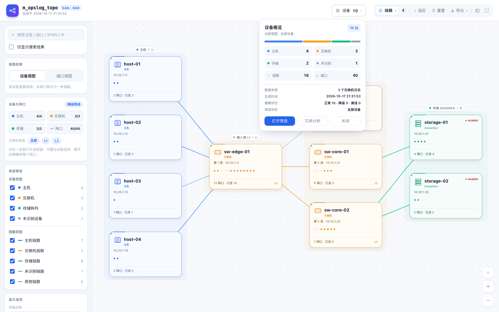

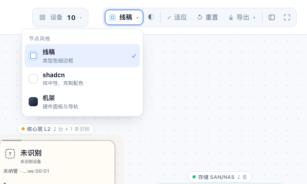

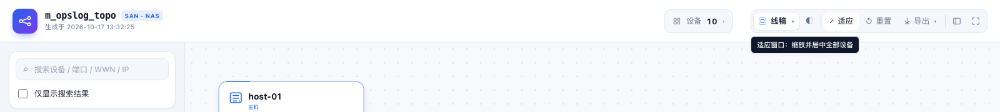

<a id="sec-5-2"></a>

### 5.2 导出与视图

导出支持 PNG / JPG / WebP，并可选 1× / 2× / 3× 清晰度：

- 1×：当前画布原分辨率
- 2× / 3×：用离屏 network 重新渲染，再编码成图片，不是简单放大
- 仍然是**当前视口**，不是全图 tile 拼接

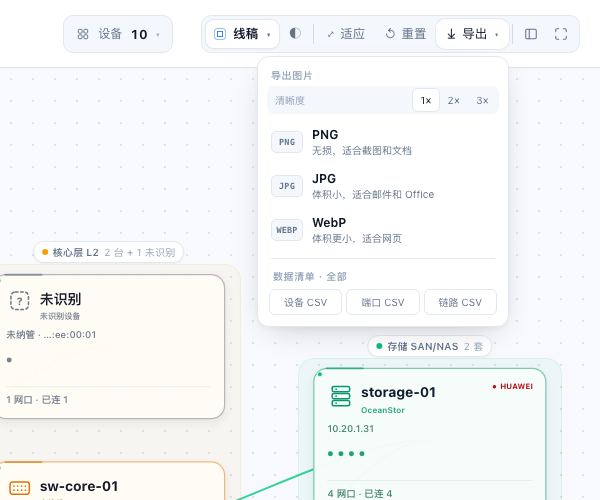

| 侧栏折叠 | 全屏预览 |
| --- | --- |
| 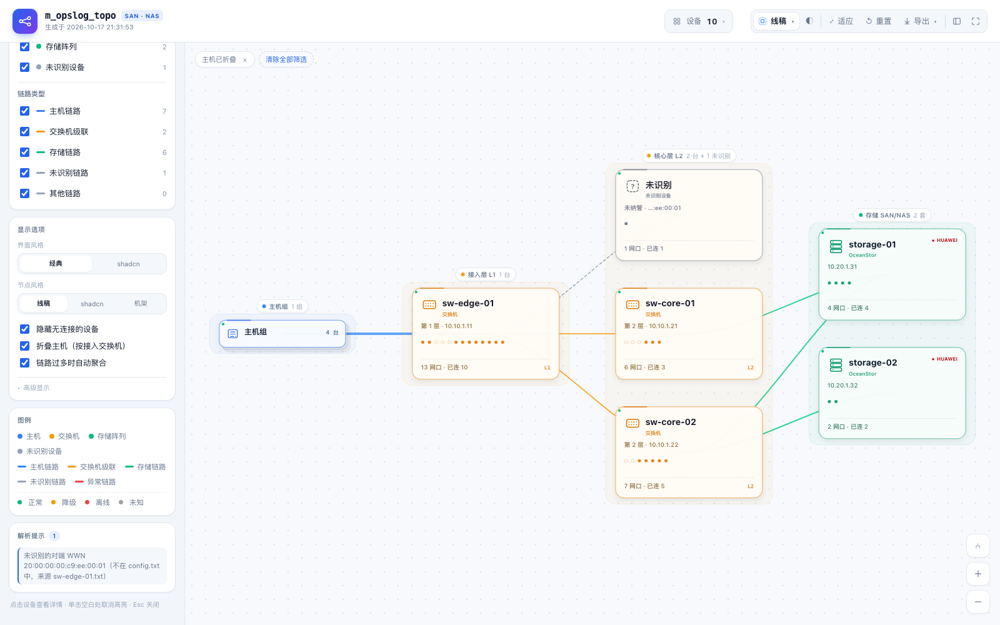 | 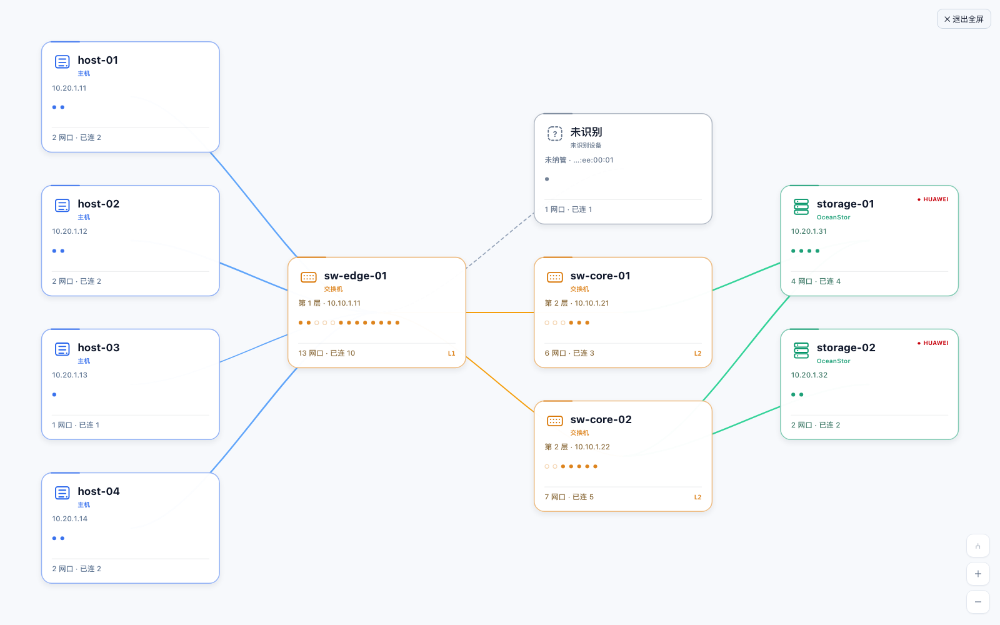 |

<a id="sec-5-3"></a>

### 5.3 设备视图 / 端口视图

- 设备视图：一台设备一张卡片，多网口聚合为一条粗线；某列设备超过 12 台时自动使用紧凑卡片
- 端口视图：每个网口一个小模块，连线表示端口到端口的物理链路；长卡片两侧的刻度与网口位置对齐

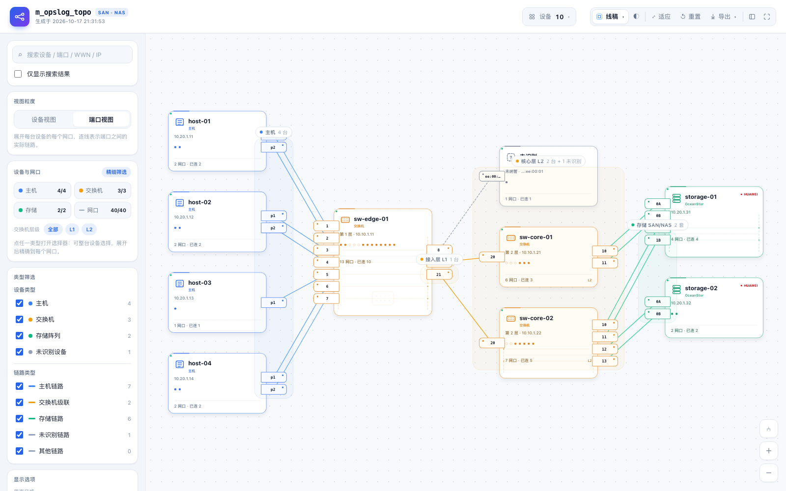

<a id="sec-5-4"></a>

### 5.4 视觉风格

界面风格和节点风格是分开的：

- **界面风格**：「显示选项 → 界面风格」切换 **经典 / shadcn**。经典是默认，恢复最初那版蓝色外壳；shadcn 是中性 zinc 外壳。两者共用同一套 DOM 和组件结构，区别只在 token。
- **节点风格**：顶栏下拉菜单或「显示选项 → 节点风格」切换，默认线稿。

| 经典 + 线稿（默认） | 经典 + 机架 | shadcn + shadcn |
| --- | --- | --- |
|  | 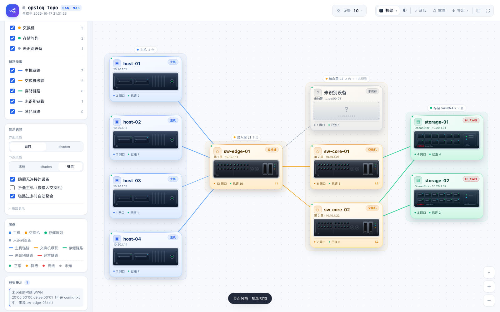 | 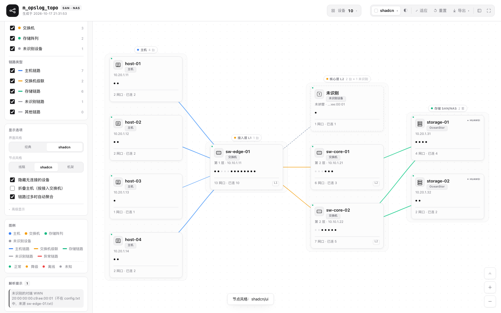 |

- **经典 + 线稿**：最初那版的观感，蓝色主色 + 类型色细边框
- **经典 + 机架**：真实前面板、机架挡板与导轨
- **shadcn + shadcn**：完整 shadcn 视觉，中性外壳 + 纯中性节点卡片

<a id="sec-5-5"></a>

### 5.5 主机组折叠（辅助功能）


默认关闭。需要时在「显示选项」勾选 **折叠主机（按接入交换机）**：

- 同一接入交换机下的主机合并成 `主机组 ×N`，默认只画组卡和聚合链路
- 组卡右侧显示台数；悬停可看接入交换机和前 10 台成员
- 点击组卡打开成员列表，可「仅展开此组」或「展开全部主机」
- 展开后左上角出现「已展开 N 组」chip，移除后这些组重新折叠
- 画布左上角出现「主机已折叠」chip，可随时移除
- **只在设备视图生效**；切到端口视图会自动禁用，回到设备视图恢复
- 主机按“主接入交换机”分组；双 Fabric 主机仍会把组链路画到两台交换机上
- 不写入 localStorage，每次打开页面默认关闭

<a id="sec-5-6"></a>

### 5.6 健康状态

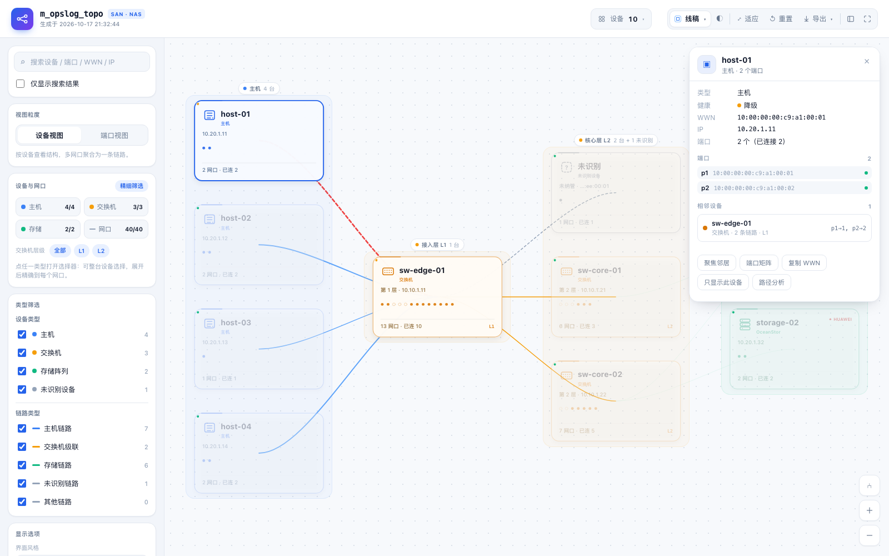

设备健康从链路状态推导，不额外依赖监控系统：

- 有 down 链路且仍有 up → **降级**（琥珀）
- 全部已知链路 down → **离线**（红）
- 全部 up → **正常**（绿）
- 没有链路或链路状态未知 → **未知**（灰）

显示位置：

- 节点卡左上角状态点（所有三套节点风格都有）
- 异常链路红色虚线；正常链路保持类型色
- 侧栏图例新增正常 / 降级 / 离线 / 未知和异常链路
- 设备概览卡显示健康计数
- 设备详情、主机组详情、端口矩阵、全局清单都带健康字段

> 状态来自日志里的 `status`；没有状态的链路按未知处理，不会误判成正常。

<a id="sec-5-7"></a>

### 5.7 SAN/NAS 冗余分析

概览卡 → **冗余分析**：

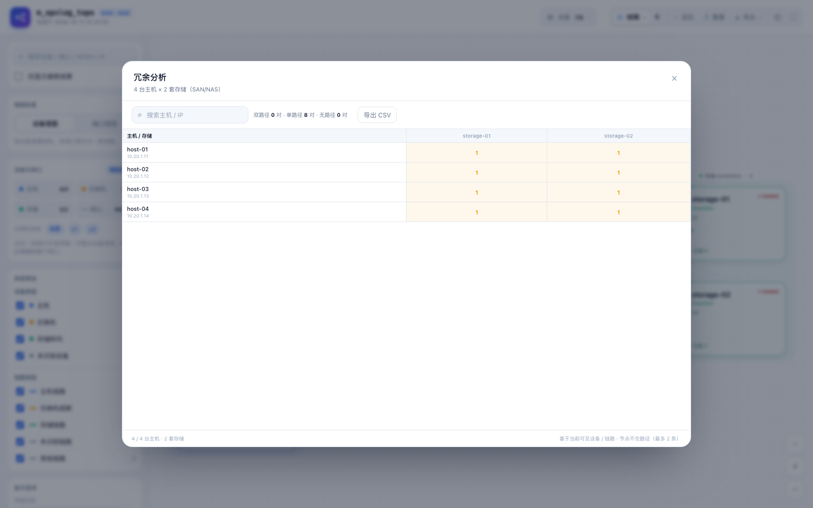

- 行：当前可见主机；列：当前可见存储（SAN/NAS 统一按 storage 处理）
- 单元格：`2` 双路径（绿）/ `1` 单路径（琥珀）/ `—` 无路径
- 路径按**节点不交**计算：交换机节点容量 1，主机/存储容量 2，最多找 2 条
- down 链路不参与计算
- 支持搜索主机 / IP，CSV 导出
- 400 台主机 × 8 套存储 = 3,200 个组合，可在浏览器内完成

边界：

- 基于**当前可见设备与链路**；如果手动隐藏了某台交换机，路径会按隐藏后的图计算
- 只回答“有几条独立路径”，不涉及 zoning、LUN mapping、多路径软件、端口带宽
- NAS 也走 storage 类型，不区分 NFS / SMB / iSCSI

<a id="sec-5-8"></a>

### 5.8 端口矩阵

设备详情面板 → **端口矩阵**：

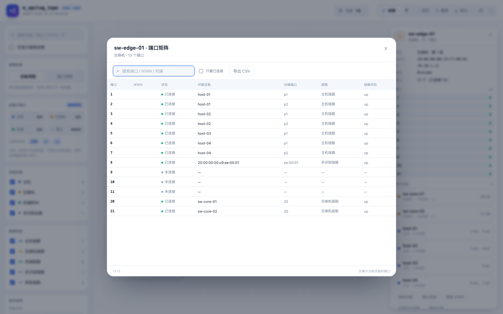

- 行：端口、WWN、状态、对端设备、对端端口、链路类型、链路状态
- 搜索端口 / WWN / 对端；可只看已连接
- 支持导出 CSV（带 BOM，Excel 可直接打开）
- 只展示当前设备，不会把全量端口铺到画布上

<a id="sec-5-9"></a>

### 5.9 分析范围

侧栏「视图粒度」里会出现 **范围** 下拉（只有数据里存在 `meta.site` / `meta.fabric` / `meta.rack` 时才显示）：

- 选项按字段分组：站点 / Fabric / 机房；config 里写 `site` / `fabric` / `rack` 即可，无需手改 graph.json
- 选中后只保留该范围设备；没有该字段的设备（通常是共享核心交换机）保留
- 活跃时画布左上角显示「范围 站点 · dc-a」chip，可移除
- 选择“全部”恢复

> 如果 config / graph.json 没有这些字段，整个控件自动隐藏，不会占用界面。

<a id="sec-5-10"></a>

### 5.10 列标题与背景带

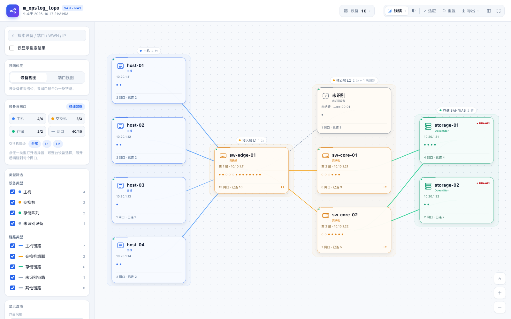

- 按布局列自动生成：主机 / 主机组、接入层 L1、核心层 L2、存储 SAN/NAS
- 列背景带用类型色低透明度；标签是屏幕固定字号，不随缩放变小
- 标签显示数量和异常提示，例如 `核心层 L2 2 台 + 1 未识别`
- 列太窄（缩放很低）时自动隐藏标签，只保留背景带
- shadcn 外壳下背景带改为中性色，避免破坏克制风格
- 窄屏（≤760px）隐藏标签，避免遮挡

<a id="sec-5-11"></a>

### 5.11 链路自动聚合

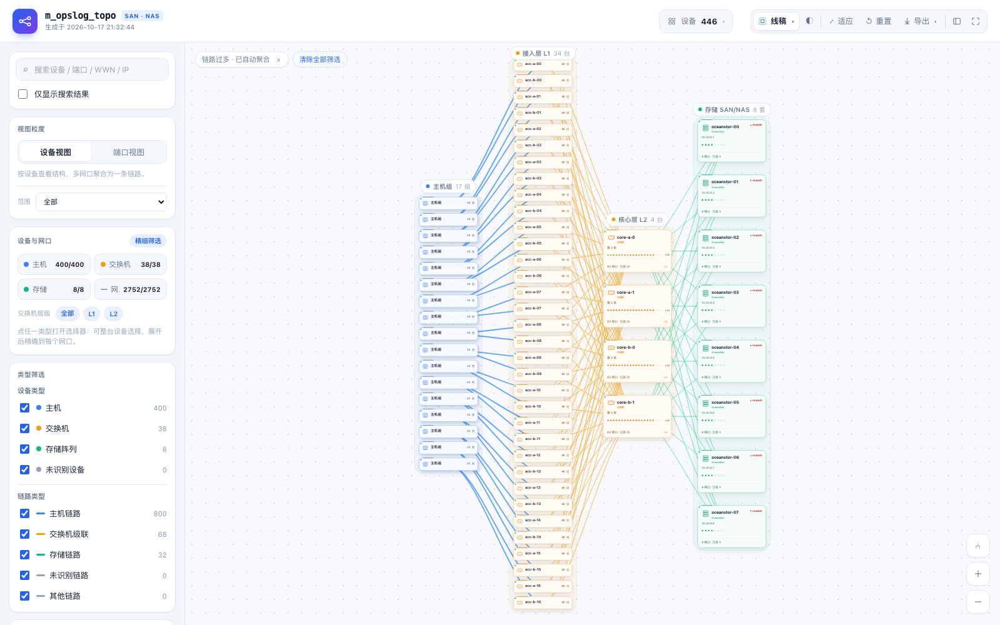

- 设备视图链路 **≥300 条且主机 ≥20 台**时，自动把主机按接入交换机折叠成组
- 目的：聚合主机 → 交换机的边，避免几百条线形成毛线球
- 左上角出现「链路过多 · 已自动聚合」chip，点 × 关闭自动聚合
- 「显示选项 → 链路过多时自动聚合」可永久关掉（当前会话）
- 手动勾选「折叠主机」时，以手动折叠为准
- 组卡仍可点开、仅展开此组或展开全部主机
- 不修改数据，只影响显示层

<a id="sec-5-12"></a>

### 5.12 范围面板

“设备与网口”面板里四个入口：

| 入口 | 作用 |
| --- | --- |
| 主机 `4/4` | 打开选择器并定位到主机列表，可逐台勾选 |
| 交换机 `3/3` | 同上，按层级排序 |
| 存储 `2/2` | 打开后展开设备即可按网口勾选 |
| 网口 `40/40` | 直接打开并展开所有设备的网口列表 |

数字是“当前显示 / 总数”。发生过筛选时卡片会高亮。

<a id="sec-5-13"></a>

### 5.13 精细筛选器

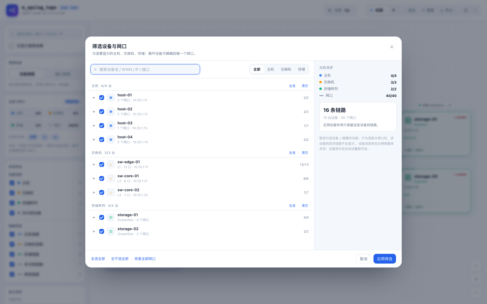

- 顶部搜索：设备名、WWN、IP、端口名都可以搜；搜到端口时会自动展开并只显示匹配的网口
- 搜索后会出现结果条：`搜索结果 N 台设备 · 全选结果 · 清空结果`；分组头的「全选/清空」也会切换成结果级操作
- 设备行：三态复选框（全选 / 部分 / 全不选）、类型图标、端口计数
- 展开设备：每个网口一行，显示名称、WWN、连接状态
- 右侧实时预估：应用后会显示多少台设备、多少个网口、多少条链路
- 底部：全选全部 / 全不选全部 / 恢复全部网口，或取消 / 应用；这两个是全局操作，和搜索结果操作区分
- 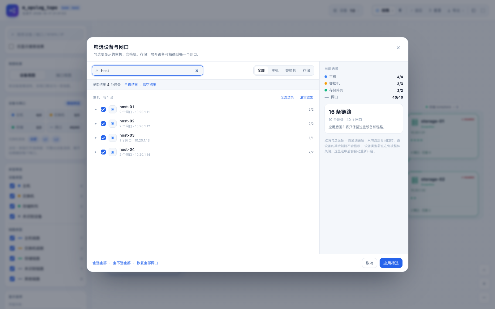

所有筛选都支持组合：类型开关 × 逐台设备 × 单个网口 × 交换机层级 × 链路类型 × 在线状态

网口筛选是**全局生效**的：在设备视图里也会少掉对应链路，设备卡片会标注“（显示 N）”。

<a id="sec-5-14"></a>

### 5.14 几百台主机时的筛选器

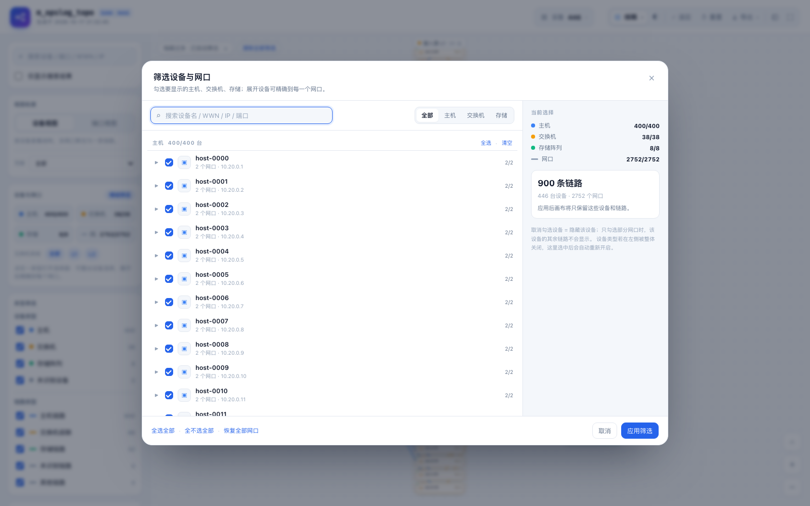

当前行为：

- 全部设备行一次性渲染；400 台主机 / 446 台设备时列表约 20,646px 高，约 36 屏
- 类型分组头是 sticky 的，滚动时「主机 400/400 · 全选 · 清空」会固定在顶部；有搜索时按钮变成「全选结果 / 清空结果」
- 打开 400 台设备的 picker 约 1 秒多；没有虚拟滚动，1000+ 会明显变慢
- 搜索、全部/主机/交换机/存储 tab 是主要入口；展开设备后才渲染端口行
- 无搜索时分组头作用于整个类型；有搜索时只作用于当前匹配结果
- 底部「全选全部 / 全不选全部」始终是全局操作，避免和搜索结果混淆
- 右侧始终显示当前选择、设备/网口/链路预估

> 几百台时建议先用搜索或 tab 缩小到几十台；如果经常全量浏览，下一步应做「按接入交换机分组 + 折叠」或虚拟滚动。

<a id="sec-5-15"></a>

### 5.15 已生效筛选条

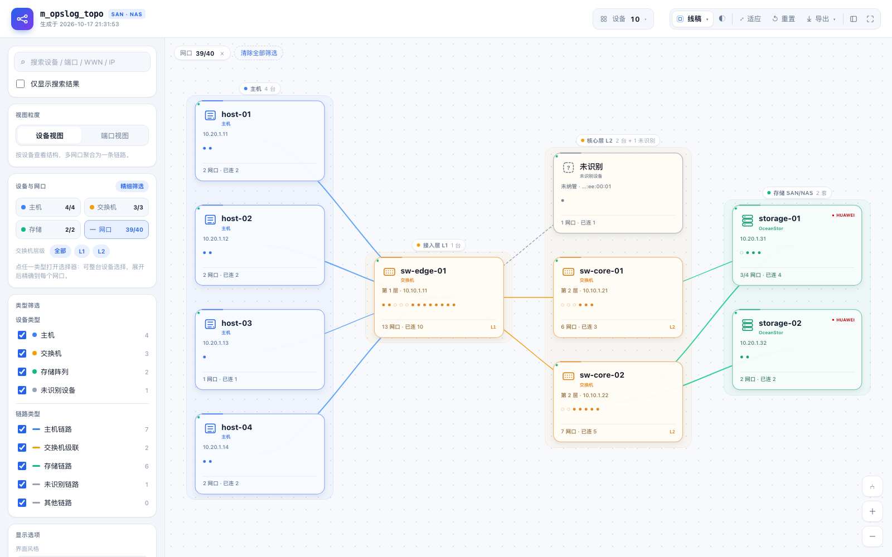

画布左上角会列出当前生效的条件，例如：

```
主机 1/4 ×   网口 39/40 ×   层级 L2 已隐藏 ×   清除全部筛选
```

点 chip 上的 × 只移除这一项，点“清除全部筛选”恢复全部设备。

<a id="sec-5-16"></a>

### 5.16 其他操作

| 操作 | 效果 |
| --- | --- |
| 点击设备卡片 | 高亮邻居并打开详情 |
| 详情里的“只显示此设备” | 隐藏其他所有设备，保留当前设备 |
| 详情里的“聚焦邻居” | 只高亮直接相连的设备 |
| 右下角“⑃” | 路径分析，依次点两台设备 |
| `Esc` | 关闭选择器 / 退出路径分析 / 取消高亮 / 退出全屏 |
| 顶栏「设备」按钮 | 打开设备 / 链路概览卡，后续内容可扩展 |
| 显示选项 → 折叠主机 | 按接入交换机折叠主机组（默认关闭，仅设备视图） |
| 视图粒度 → 范围 | 按 site / fabric / rack 过滤（无元数据时隐藏） |
| 详情 → 端口矩阵 | 表格查看端口 / 对端 / 状态，可导出 CSV |
| 概览 → 冗余分析 | 主机 × 存储独立路径矩阵，可导出 CSV |
| 显示选项 → 自动聚合 | 链路 ≥300 时自动折叠主机组，chip 可关闭 |
| 导出 → 数据清单 | 设备 / 端口 / 链路 CSV（全部数据） |
| 导出 → 2× / 3× | 当前视口高分辨率重新渲染 |
| 顶栏节点风格下拉 | 切换节点风格，选择自动记忆 |
| 显示选项 → 界面风格 | 切换经典 / shadcn 外壳，选择自动记忆 |
| 滚轮 / 拖拽 | 缩放 / 平移；“适应”回到全图 |
| “导出” | 选择 PNG / JPG / WebP 导出当前视图 |
| 侧栏图标 | 收起 / 展开左侧筛选栏 |
| 全屏图标 | 拓扑区全屏预览，`Esc` 退出 |

<a id="sec-6"></a>

## 6. 目录结构

```
topo.py                    主程序：解析 → 中间产物 → 渲染
template/index.html        页面骨架
template/style.css         样式（shadcn 外壳 + 三套节点风格）
template/app.js            绘制、筛选、布局、交互
assets/vis-network.min.js  图渲染库（构建时内联进 HTML）
sample/config.txt          样例主机 / 存储配置
sample/logs/*.txt          样例交换机日志（三种不同写法）
sample/topology.graph.json 自动生成的完整中间产物
sample/mini.graph.json     手写的最小中间产物
docs/graph-schema.md       中间产物 schema（v1）
docs/architecture.md       架构与 shadcn 演进方案
docs/preview-*.png         预览图
topology.html              生成的成品（可直接打开）
```

> 分发时只需要 `topo.py + template/ + assets/`。生成的 HTML 是独立的，不需要这些文件。

<a id="sec-7"></a>

## 7. 输入格式

<a id="sec-7-1"></a>

### 7.1 config.txt（主机 + 存储）

推荐写法：

```ini
[host host-01]
ip = 10.20.1.11
site = dc-a
fabric = A
port p1 = 10:00:00:00:c9:a1:00:01
port p2 = 10:00:00:00:c9:a1:00:02

[host host-02]
ip = 10.20.1.12
port p1 = 10:00:00:00:c9:a2:00:01

[storage storage-01]
port 0A = 20:00:00:00:c9:b1:00:01
port 0B = 20:00:00:00:c9:b1:00:02
```

规则（大小写不敏感）：

| 内容 | 支持的写法 |
| --- | --- |
| 设备段落 | `[host 名称]`、`[storage 名称]`、`[switch 名称]`；也支持 `host: 名称`、`hosts.名称` 等 |
| 类型别名 | 主机 `host/hosts/server/主机`；存储 `storage/storages/array/san/存储`；交换机 `switch/sw/交换机` |
| 网口 / WWN | `port p1 = WWN`、`port: 0A` 加下一行 `wwn: WWN`、`0A = WWN`，一行多个 WWN 用逗号分隔 |
| 可选字段 | `ip`、`hostname` / `name` / `id`、`type`、`site` / `fabric` / `rack`、`vendor` / `model` |
| 紧凑写法 | `[hosts]` 段内 `host-01: wwn1, wwn2`；`[storages]` 段内 `storage-01: wwn1` |
| 表格文件 | 带表头的 CSV / TSV：`type,id,port,wwn,ip`（列名可换顺序、可只保留需要的列） |

WWN 支持 `10:00:00:00:c9:a1:00:01`、`10-00-00-...`、16 位连续十六进制、`0x` 前缀；一个 WWN 就是一个网口。

没有明确类型的设备默认按“主机”处理，并在解析提示里给出提醒。

<a id="sec-7-2"></a>

### 7.2 交换机日志

每个文件一台交换机。**必需**：交换机名称（缺失时用文件名）、交换机自身 WWN、每个端口的“本地端口 + 对端 WWN”。推荐再带上 `peer_port` 和 `status`。

样例里演示了三种写法，解析器都支持：

**A. 单行键值**

```
Switch Name: sw-edge-01
Switch WWN: 10:00:00:00:c9:ff:00:01
IP Address: 10.10.1.11

port 1  status online speed 32G peer_wwn 10:00:00:00:c9:a1:00:01
port 20 status online speed 32G peer_wwn 10:00:00:00:c9:ff:00:02 peer_port 20
```

**B. 表格式**

```
Switch Name: sw-core-01
Switch WWN: 10:00:00:00:c9:ff:00:02

Index  Port  Address   Peer_WWN                  Peer_Port  Status
0      10    0x010900  20:00:00:00:c9:b1:00:01   0A         online
2      20    0x011300  10:00:00:00:c9:ff:00:01   20         online
```

**C. key=value 单行**

```
port=10; peer_wwn=20:00:00:00:c9:b1:00:03; peer_port=1A; status=connected
```

**D. Cisco `show flogi database` 风格**（一行两个 WWN）也兼容：

```
Interface  VSAN  FCID      PORT NAME                NODE NAME
fc1/1      1     0x010001  10:00:00:00:c9:a1:00:01  10:00:00:00:c9:a1:00:01
```

端口状态词支持 `online / up / connected / active / 启用 / 在线`，以及
`offline / down / notconnected / disabled / 禁用 / 离线`；空闲端口可用 `No_Module`、`notconnected`、`未使用` 等标记。

<a id="sec-7-3"></a>

### 7.3 WWN 匹配逻辑

1. 对端 WWN = config.txt 里某主机 / 存储的网口 → 主机链路 / 存储链路
2. 对端 WWN = 另一台交换机的 **Switch WWN** → 交换机级联链路
3. 都不是 → “未识别设备”（灰色虚线节点），并在解析提示中列出
4. 级联链路如果两侧日志都只给了对方交换机 WWN、没给对端端口号，会按端口顺序把两侧记录配对；两侧都给了 `peer_port` 时直接采用

<a id="sec-7-4"></a>

### 7.4 层级是怎么算的

- 主机固定在第 0 层
- 直接连主机的交换机 = 第 1 层；沿交换机级联关系 BFS 得到 2、3… 层
- 存储放在其相邻交换机的最右侧
- 未识别设备放在相邻设备的右边

<a id="sec-8"></a>

## 8. 扩展性（给后续开发）

<a id="sec-8-1"></a>

### 8.1 先理解契约

所有能力都建立在 `graph.json` 上：

```text
devices[]  ── 设备 + ports[]
links[]    ── a/b 两端 + kind/status/meta
warnings[] ── 解析提示
sources    ── 数据来源
groups     ── 预留的业务分组字段（当前渲染器不消费）
```

- 设备/端口/链路的 `meta` 是**自由字段**，渲染器会保留但不一定展示
- `normalize_graph` 只依赖 `schema_version`、`devices`、`links`；未知字段不丢
- 因此新增业务属性通常不需要改数据契约，只需要在 UI 里“取出来展示”

<a id="sec-8-2"></a>

### 8.2 加信息：优先走 `meta`

| 想加的内容 | 放哪里 | 展示位置 | 改动量 |
| --- | --- | --- | --- |
| 机房、机架、租户、业务组、标签 | `device.meta.site / rack / tenant / group / tags` | 详情、概览卡、搜索 | 小 |
| 厂商、型号、序列号、固件 | `device.meta.vendor / model / serial / firmware` | 详情（厂商/型号已支持） | 小 |
| 端口速率、光模块、VLAN | `port.meta.speed / optic / vlan` | 详情端口行、端口 tooltip | 小 |
| 链路带宽、误码、利用率 | `link.meta.*` | 边标签、线宽、详情 | 中 |
| 设备健康、告警数 | `device.meta.health / alerts` | 卡片角标、概览卡 | 中 |
| 新统计指标 | 不需要进图数据 | 概览卡的 `summary-stats` / `summary-extra` | 小 |

具体落点：

- **详情面板**：`showDetail()` 里加 `<dt>/<dd>` 行；存储厂商/型号已有示例
- **概览卡**：`updateStats()` 的 `entries` 或 `rows` 加一项即可
- **搜索**：在 `deviceOnlyMatches()` / `deviceMatches()` 里加字段匹配
- **筛选**：在 `state` 里加开关，在 `computeView()` 里参与可见性计算
- **卡片**：在三种 `draw*DeviceNode` 里加字段；如果只加详情，则不用动 canvas

<a id="sec-8-3"></a>

### 8.3 加筛选 / 视图

当前筛选状态：

```js
state.types        // 设备类型
state.kinds        // 链路类型
state.hiddenLayers // 交换机层级
state.offDevices   // 逐台隐藏
state.offPorts     // 逐口隐藏
state.query        // 搜索
state.isolateQuery // 搜索是否直接过滤
```

新增筛选的路径：

1. 在 `state` 加字段
2. 在 `computeView()` 里把字段并入 `visible`
3. 在侧栏或 picker 加控件
4. 在 `renderFilterBar()` 里加可移除的 chip
5. 在 `resetFilters()` 里恢复默认

如果要按 `site` / `rack` 做**视觉分组**，仅加筛选不够；需要动 `layout()` 和容器绘制，属于下一档改造。

<a id="sec-8-4"></a>

### 8.4 加设备类型 / 链路类型（较大）

新增设备类型（例如防火墙、负载均衡、NAS 头）需要同时改：

| 位置 | 需要改什么 |
| --- | --- |
| `topo.py` | `TYPE_LABEL`；如果是输入解析，还要 `guess_type` / `TYPE_ALIASES` |
| `template/app.js` | `TYPE_LABEL`、`TYPE_ICON`、`palette()`、`drawTypeGlyph()`、`TYPE_ORDER` |
| `computeRanks()` / `layout()` | 新类型放在第几层、和谁相邻、列顺序 |
| 三种节点渲染 | `drawLine*` / `drawShadcn*` / `drawSkeuo*` |
| 筛选与统计 | `renderTypeFilters()`、`renderKindFilters()`、picker 分组、`updateStats()` |
| 视觉资产 | `style.css` 的类型色变量、图例、picker 图标 |
| 数据契约 | `docs/graph-schema.md` 的 `type` 枚举 |

新增链路类型（例如“复制链路”“跨机房链路”）需要改：

- `KIND_LABEL` / `KIND_ORDER`
- `EDGE_COLOR` / `edgeColors()` 和边样式
- 链路筛选、图例、`renderFilterBar()`
- `normalize_graph` 的 `kind` 默认推导

> 结论：**加信息容易，加类型/结构难**。如果只是新业务属性，优先放 `meta`，不要急着加 `type`。

<a id="sec-8-5"></a>

### 8.5 加数据源（推荐方式）

不要把新系统直接塞进 `parse_config` / `parse_switch_log`。更稳的方式：

```text
CMDB / API / Excel / 监控
        ↓ 适配器
topology.graph.json（schema 1.0）
        ↓
python3 topo.py --graph graph.json -o topology.html
```

这样渲染器、布局、筛选、导出全部复用；解析器只保留“交换机日志”这一个适配器。

<a id="sec-8-6"></a>

### 8.6 加视觉风格 / 卡片

- 节点风格入口：`drawDeviceNode()` / `drawPortNode()` 的 dispatcher
- 菜单项：`template/index.html` 的 `data-style` 按钮 + `setStyle()` 白名单
- 持久化：`topo-style-v3`
- 样式小样：`style.css` 的 `.swatch.*`
- 新增一套风格时，至少实现 `drawXxxDeviceNode` 和 `drawXxxPortNode`

<a id="sec-8-7"></a>

### 8.7 大规模能力路线

如果后续要支撑几百到几千台主机，建议按顺序做：

1. **主机组折叠 + 分析范围**：已实现（默认关闭；折叠按接入交换机，范围按 site/fabric/rack）
2. **LOD**：低缩放只画组块/色块，不画文字和端口点阵
3. **链路聚合**：主机组 → 交换机画一条粗边，标 `×N`
4. **端口视图聚焦**：端口矩阵已提供表格视图；后续可让端口画布只渲染选中设备
5. **Web Worker / 预计算布局**：避免几百设备时主线程卡 2–3 秒
6. **视口裁剪 / WebGL**：几千节点再考虑

<a id="sec-8-8"></a>

### 8.8 改动后的验收

```bash
python3 -m py_compile topo.py
node --check template/app.js
python3 topo.py --config sample/config.txt --logs sample/logs -o /tmp/t.html
python3 topo.py --graph sample/mini.graph.json -o /tmp/mini.html
```

再用浏览器检查：默认视图、筛选、picker、详情、导出、全屏、移动端，以及 console 无报错。

<a id="sec-9"></a>

## 9. 大规模场景：搜索、过滤与导出

下面这组数据来自合成拓扑（双 Fabric、8 台存储、接入/核心两层交换机），headless Chromium，1600×1000：

| 主机数 | 设备 | 链路 | 首屏加载 | 全量 rebuild | 设备视图缩放 | 卡片屏幕高度 | 端口节点 | 端口视图缩放 |
| --- | --- | --- | --- | --- | --- | --- | --- | --- |
| 50 | 68 | 144 | 0.25s | 117ms | 0.31 | 14px | 356 | 2.4px |
| 100 | 122 | 252 | 0.55s | 260ms | 0.16 | 7px | 626 | 1.3px |
| 200 | 230 | 468 | 1.48s | 747ms | 0.08 | 3.7px | 1,166 | 1.3px |
| 400 | 446 | 900 | 4.86s | 2.59s | 0.05（触底） | 2.3px | 2,246 | 1.3px |

> 数字用于看趋势，不是性能承诺。卡片屏幕高度是“46px 紧凑卡片 × 缩放”，文字实际更小。

<a id="sec-9-1"></a>

### 9.1 搜索

- 搜索会匹配：设备名、WWN、IP、端口名、端口 WWN、存储厂商/型号
- **默认只高亮，不改变拓扑**；勾选「仅显示搜索结果」才会重建/过滤
- 400 台设备时搜索唯一主机并勾选隔离：命中 1 台，视图只剩 1 个节点，缩放 1.4，完全可读
- 搜索 `host` 这类宽泛词会命中几百台，即使隔离也没有意义
- Picker 的搜索只筛列表，不改变画布；400 台设备 / 2,752 个端口时设备行 446 行，端口行只有展开设备才渲染

<a id="sec-9-2"></a>

### 9.2 过滤

- 类型、链路类型、层级、逐台设备、逐口、搜索隔离可以叠加
- 每次筛选都会 `computeView()` + 重新布局 + 重绘；耗时跟**当前可见规模**相关，但全量重建在 400 台时约 2.6 秒
- 400 台设备时隐藏主机，可见设备降到 46 台，缩放回到 0.4 左右，图谱恢复可读
- 开启主机组折叠（或链路 ≥300 自动聚合）后：446 设备 / 900 链路 → **63 节点 / 134 链路**，缩放从 0.05 回到 **0.45**；17 个主机组，图谱重新可浏览
- 自动聚合默认开启：**300 条可见链路 + ≥20 台主机**触发；chip 可关闭；手动折叠优先
- 400 台主机 × 8 套存储的冗余矩阵 = 3,200 个组合，浏览器内可完成
- 全局清单导出 446 行设备 / 2,752 行端口 / 900 行链路
- 但这不是“虚拟化”：隐藏不等于不计算，首次全量重建仍然慢
- 大规模下正确姿势：**先筛到 Fabric / 交换机 / 一组主机，再看端口视图**；不要一上来全量端口视图

<a id="sec-9-3"></a>

### 9.3 图片导出

**当前导出是 WYSIWYG：截取当前画布的可见视口，不会自动把全图展开或拼接。**

- 导出内容 = 当前 canvas + 列标题/背景带（已应用筛选、当前缩放/平移、当前主题）；不包含侧栏、顶栏、详情面板
- 健康状态点、异常链路、主机组叠层也会一起导出
- 分辨率 = 画布背板尺寸；测试中 1600×1000 窗口、侧栏展开时是 **1304×932**
- 不会自动 fit；如果当前是放大状态，导出的就是放大后的局部
- 关闭自动聚合、强行点「适应」时，`fitGraph` 仍有 **0.05 的最小缩放**；400 台设备实测有 **79 个节点在视口外**，所以“适应”≠“全部显示”
- 关闭自动聚合后，400 台设备导出的全图 PNG 约 90KB，但内容只有 2px 高的卡片，没有阅读价值
- 当前支持 **当前视口 1× / 2× / 3×** 高清导出（2× 实测 2608×1864，文件约 360KB）；2×/3× 是重新高分辨率渲染，不是放大模糊图
- 想让导出可读：**先筛到某个交换机 / 存储 / 一组主机，再适应或放大后导出**
- 仍没有“完整全图 tile 拼接”能力

<a id="sec-9-4"></a>

### 9.4 全局清单导出

导出菜单 → **数据清单 · 全部**：

- **设备 CSV**：类型、名称、ID、WWN、IP、端口数、已连接端口、健康、厂商、型号、站点、Fabric、机房
- **端口 CSV**：设备、端口、WWN、连接状态、未使用、对端设备/端口、链路类型/状态、来源
- **链路 CSV**：两端设备/端口/WWN、链路类型、状态、速率、来源
- 三个文件都带 UTF-8 BOM，Excel 直接打开不乱码
- 导出的是**全部数据**，不受当前画布筛选影响；适合做资产核对、变更前后对比

<a id="sec-9-5"></a>

### 9.5 完整全图高清导出（未实现）

如果要做“完整拓扑、可读分辨率”的导出，复杂度不是“截个图”，大致需要：

1. 计算全图包围盒和目标缩放（不能再用 0.05 的 fit 缩放）
2. 处理浏览器 canvas 尺寸/显存上限，按 tile 网格移动相机
3. 相邻 tile 留 overlap，避免节点/边在拼接处被切断
4. 把 tile 拼到一张大 canvas，再编码成 PNG/JPG/WebP
5. 进度、取消、最大像素/内存保护
6. 标签、边、hover/选中状态在 tile 边界的一致性

判断：**中等偏高**。400 台主机在可读缩放下，单张全图可能到 1 万像素级，内存和编码都不轻；如果先做主机组折叠/范围筛选，通常不需要全图导出。**“当前范围 2×/3× 高清导出”已经实现**，不需要 tile；完整的全图 tile 拼接仍未实现，建议单独排期。

<a id="sec-9-6"></a>

### 9.6 容量判断

| 场景 | 判断 |
| --- | --- |
| 10–30 台主机、少量交换机/存储 | 全量视图可用 |
| 50 台左右主机 | 能看结构，文字已很小；需要筛选 |
| 100–200 台主机 | 全量不可读；搜索隔离/类型筛选后可用 |
| 400+ 台主机 | 默认自动聚合后可用（63 节点 / 0.45 缩放）；关闭自动聚合后全量单主机视图不可读 |
| 全量端口视图 | 20–30 台设备以上就不建议；只对单台设备/交换机使用 |
| 全量 CSV 清单 | 设备/端口/链路都可导出，不做分页 |
| 几千台设备 | 需要分组、LOD、边聚合、Web Worker/WebGL，当前架构不适合 |

**一句话：搜索和过滤在“缩小范围”这件事上是好用的；导出是“当前视口截图（可 1×/2×/3× 重渲染）”，不是“完整全图高清导出”；大规模场景的核心问题是全量布局与可读性，不是文件大小或数据解析。**

<a id="sec-10"></a>

## 10. 常见问题

**Q：解析不到链路怎么办？**
先用 `--dump` 看输出的链路列表，再检查：① 日志里是否有 `Switch WWN`；② 每个端口行是否同时含本地端口号和 `peer_wwn`；③ 是否一个文件里放了多台交换机（请拆分）。

**Q：主机 / 存储显示成“未识别”？**
说明日志里的对端 WWN 在 config.txt 中找不到。对照 `--dump` 的“未识别”列表检查 WWN 是否一致（注意 `10:00:` 与 `20:00:` 前缀、有没有多/少一位）。

**Q：层级不对？**
层级是按“连主机的交换机为 L1，再沿级联 BFS”推出来的。如果主机实际接在核心交换机上，它也会被当成 L1——这反映的是真实物理连接，不是管理分层。可以用“交换机层级”chip 只看某一层。

**Q：只想看某几台主机 / 某个存储的某几个口？**
打开“设备与网口 → 精细筛选”，勾选/展开设备；应用后画布左上角会显示筛选 chip，随时可以单独移除。

**Q：端口视图太大？**
先用“交换机层级”或“设备与网口”收缩范围，或搜索后勾选“仅显示搜索结果”；“显示未使用端口”默认关闭。

**Q：真实日志格式和样例不一样？**
解析规则集中在 `topo.py` 顶部：`SWITCH_*_RE`、`PORT_PATTERNS`、`PEER_*`、`UNUSED_WORDS`、`TYPE_ALIASES`，按实际格式改正则即可。也可以发一份脱敏样例，直接适配。

**Q：数据安全？**
生成过程不联网，HTML 不引用外部资源；但生成的 HTML 内含完整拓扑和 WWN，请按敏感文件管理。

<a id="sec-11"></a>

## 11. 已知边界

- 一个日志文件只解析一台交换机
- WWN 按 16 位十六进制（8 字节）识别；非标准长度会跳过
- 交换机端口默认按“端口号字符串”区分；不同厂商的 `fc1/1` 与 `1/1` 不会自动视为同一端口
- 不做链路聚合 / 双活语义合并：每个物理端口互联就是一条链路，设备视图里以一条粗线聚合展示
- 级联缺对端端口号时按端口顺序配对，属于启发式；两侧都写 `peer_port` 最准确
- 大规模：所有主机默认排在同一 rank 列；`fitGraph` 最小缩放 0.05，几百台时会出现“适应了但没完全显示”
- 主机组折叠默认关闭、不持久化；只对设备视图生效，按主接入交换机分组，双 Fabric 主机会把组链路画到多个交换机
- 链路 ≥300 且主机 ≥20 时自动聚合；这是显示层折叠，不改变数据；可关闭
- 健康状态从链路 status 推导；没有 status 的链路为未知，不会自动当作正常
- 冗余分析最多数 2 条节点不交路径；不涉及 zoning、LUN mapping、多路径软件、端口带宽；NAS 不区分 NFS/SMB/iSCSI
- 冗余分析基于当前可见设备/链路；隐藏交换机后结果会变
- 全局清单导出的是全部数据，不跟随当前画布筛选
- 列标题/背景带在缩放很低或窄屏时自动隐藏标签，只保留背景带
- 导出是当前视口（可选 1×/2×/3× 高清重渲染），不是全图高清/分块拼接；缩放到哪里、筛出什么，就导出什么
- 分析范围依赖 meta.site/fabric/rack；没有字段的设备视为共享设备保留
- 端口矩阵展示的是当前设备的原始端口/链路，不跟随画布的端口筛选
- 搜索默认只高亮；勾选「仅显示搜索结果」才会改变画布
- 新增设备类型/链路类型不是纯数据扩展，需要同时改解析、布局、筛选、图例和三套节点渲染
- 页面是生成时快照，不做实时刷新、增量更新或服务端权限

---

[↑ 返回目录](#toc)
